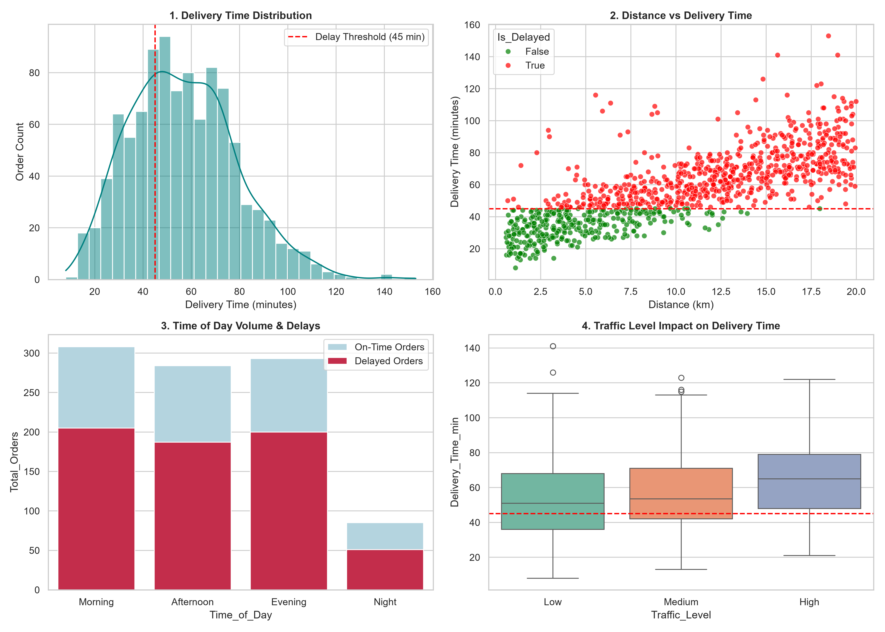

# 🚴 Food Delivery Time and Order Analysis (Project ID: DA-005)

**University:** Invertis University, Bareilly  
**Program:** BCA AI (Semester I, Section A)  
**Group ID:** BCA_AI_05  
**Mentor Name:** Mr. Vishnu  
**Project Lead:** Sudheer Kumar  

---

## 📌 Project Overview
This Data Analytics project analyzes a real-world food delivery dataset containing **1,000 order records** (`Food_Delivery_Times.csv`) to identify key operational bottlenecks impacting delivery durations. The objective is to analyze how factors like distance, traffic conditions, weather, and preparation time contribute to delays.
📄 **[Click Here to View Full Project Report (PDF)](project_report.pdf)**  
📊 **[Click Here to View Presentation Deck (PPTX)](Food_Delivery_Analysis_DA005_Presentation-v3.pptx)**

---

## 🎯 Problem Statement
Delivery operations frequently experience severe delays (>45 minutes), leading to customer dissatisfaction. Our goal is to measure key delivery performance indicators (KPIs), define delay thresholds, identify delay patterns across peak hours/traffic, and suggest actionable business solutions for operations teams.

---

## 🛠️ Data Cleaning & Preprocessing
The raw dataset contained 30 missing values across multiple feature columns. To prepare the dataset for analysis:
- **Mode Imputation:** Applied to missing values in categorical fields (`Weather`, `Traffic_Level`, `Time_of_Day`).
- **Median Imputation:** Applied to numerical fields (`Courier_Experience_yrs`).
- **Threshold Definition:** Standard delivery benchmark set at **45 minutes**. Deliveries exceeding this limit were flagged as `Is_Delayed = True`.

---

## 📊 Key Analytical Findings & KPIs

| Metric Name | Calculated Value | Operational Insight |
| :--- | :--- | :--- |
| **Total Orders Analyzed** | 1,000 | Full dataset sample size |
| **Average Delivery Time** | 56.73 mins | Overall mean delivery duration |
| **Median Delivery Time** | 55.50 mins | Midpoint duration distribution |
| **Min / Max Time** | 8.0 min / 153.0 min | Minimum & maximum recorded times |
| **Delay Threshold** | 45.0 minutes | Standard SLA limit |
| **Delayed Orders (>45 min)**| 664 (66.40%) | Percentage of delayed deliveries |

---

## 📈 Visualizations & Insights



1. **Delivery Time Distribution (Histogram & KDE):** Visualizes the skewed distribution centered around 50–70 minutes.
2. **Distance vs Delivery Duration (Scatter Plot):** Demonstrates a strong positive correlation where order distances exceeding **10 km** almost always result in delays (>45 mins).
3. **Time of Day Order Volume & Delays (Bar Chart):** Peak volumes occur during **Morning** and **Evening** time slots, which also account for the highest volume of delayed deliveries.
4. **Traffic Level Impact (Box Plot):** High traffic levels shift the median delivery time significantly upward to **~65 minutes**.

---

## 💡 Business Recommendations
1. **Dynamic ETA Buffering:** Add an automatic 15-20 minute buffer to estimated delivery times during High Traffic hours and Rainy weather.
2. **Geofenced Delivery Radius:** Restrict maximum delivery distance to 8 km during peak morning and evening hours.
3. **Courier Deployment Strategy:** Assign experienced couriers (>3 years experience) to high-distance or high-traffic orders to mitigate transit delays.

---

## 🛠️ Tech Stack & Setup
- **Programming Language:** Python 3.x
- **Development Environment:** VS Code / Jupyter Notebook
- **Libraries Used:** `pandas`, `numpy`, `matplotlib`, `seaborn`

---

## 👥 Group Members (Group BCA_AI_05)

| Sr. No. | Student Name | Student ID | Roll No. | Role / Responsibility |
| :---: | :--- | :---: | :---: | :--- |
| 1 | **SUDHEER KUMAR** | BCAI2026069 | 2610206191 | Project Lead & Code Implementation |
| 2 | VYOM SHARMA | BCAI2026071 | 2610206218 | Presentation & Documentation |
| 3 | SUBRAT MISHRA | BCAI2026082 | 2610206190 | Presentation & Visuals |
| 4 | ASHISH KUMAR | BCAI2026131 | 2610206046 | Presentation & Analysis |
| 5 | ADITY PRATAP SINGH | BCAI2026136 | 2610206010 | Presentation & Slides |
| 6 | FAZILAT KHAN | BCAI2026202 | 2610206072 | Presentation & QA |
| 7 | SAMEER RAJ | BCAI2026223 | 2610206161 | Presentation & QA |
| 8 | SHALINI KUMARI | BCAI2026232 | 2610206173 | Presentation & Content |
| 9 | RAHUL KUMAR | BCAI2026235 | 2610206147 | Presentation & Content |
| 10 | HIMANSHU KUMAR CHANDEL | BCAI2026236 | 2610206079 | Presentation & Review |

---

## 🚀 How to Run locally
```bash
# Clone the repository
git clone [https://github.com/sudheer-kumar01/Food-Delivery-Time-Analysis-DA005.git](https://github.com/sudheer-kumar01/Food-Delivery-Time-Analysis-DA005.git)

# Navigate to project directory
cd Food-Delivery-Time-Analysis-DA005

# Install requirements
pip install pandas numpy matplotlib seaborn

# Run the python script
python main.py

